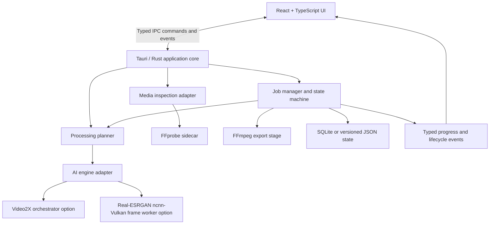

# Architecture

**Status:** Proposed architecture v0.1  
**Principles:** local-first, adapter-based, observable, cancellable, least privilege, bounded resource use.

## 1. High-level design



The UI is a client of the Rust core. The UI must not construct arbitrary commands, paths, or shell strings. The Rust core owns process execution, path checks, job transitions, temporary files, logging, and output validation.

## 2. Proposed repository layout

```text
openenhance/
├── README.md
├── PRD.md
├── ARCHITECTURE.md
├── DESIGN.md
├── API.md
├── RULES.md
├── MEMORY.md
├── THIRD_PARTY_NOTICES.md
├── LICENSE                       # add only after license decision
├── package.json
├── pnpm-lock.yaml
├── src/
│   ├── app/
│   ├── components/
│   ├── features/
│   │   ├── import/
│   │   ├── enhancement/
│   │   ├── queue/
│   │   ├── preview/
│   │   ├── history/
│   │   └── settings/
│   ├── hooks/
│   ├── lib/
│   │   ├── api/                  # typed Tauri invoke wrappers
│   │   ├── validation/
│   │   └── formatting/
│   ├── stores/
│   ├── styles/
│   └── types/
├── src-tauri/
│   ├── capabilities/
│   ├── icons/
│   ├── binaries/                 # sidecars only when license-reviewed
│   ├── src/
│   │   ├── commands/
│   │   ├── events/
│   │   ├── jobs/
│   │   ├── media/
│   │   ├── engines/
│   │   ├── storage/
│   │   ├── security/
│   │   └── main.rs
│   └── tauri.conf.json
├── tests/
│   ├── fixtures/
│   ├── integration/
│   └── benchmarks/
└── scripts/
    ├── verify-models.*
    ├── build-sidecars.*
    └── package-notices.*
```

This is a proposed layout; adapt paths to the actual Tauri scaffold rather than creating duplicate config or entrypoint files.

## 3. Technology choices

- **Desktop shell:** Tauri 2; Rust owns native operations.
- **UI:** React, TypeScript, Vite.
- **Styling:** Tailwind CSS plus accessible component primitives; motion library optional.
- **Media inspection/export:** FFprobe and FFmpeg through a controlled process adapter.
- **Upscaling:** initial candidate Real-ESRGAN-ncnn-vulkan.
- **Video orchestration:** evaluate Video2X as one engine adapter. It may wrap frame extraction, inference, and reassembly; verify its current CLI and supported OS behavior before implementation.
- **Persistence:** SQLite once history/queue persistence requires transactions; a versioned JSON preferences file is sufficient for initial settings.
- **Tests:** Vitest/React Testing Library for frontend; Rust tests; Playwright for desktop/webview smoke tests where practical; fixture-based end-to-end media tests.

## 4. Engine adapter contract

The rest of the application must not depend on one vendor's CLI flags. Define a trait/interface with operations equivalent to:

- `probe_capabilities()` — engine version, available models, GPU backend, and supported features.
- `validate_profile(profile)` — verify model files and compatible runtime.
- `run_upscale(input, output, options, progress_sink, cancellation)` — start one processing operation.
- `cancel(job_handle)` — request graceful cancellation then terminate the process group if required.
- `diagnostics()` — return safe engine/driver information without exposing secrets.

Possible adapter implementations:

1. `Video2xAdapter`: delegates whole-video/frame orchestration to a pinned and tested Video2X version.
2. `NcnnFrameAdapter`: app-level orchestration using FFmpeg/FFprobe and a Real-ESRGAN ncnn-Vulkan image/frame worker. This requires careful frame ordering, alpha/audio/subtitle handling, temporary space management and cleanup.
3. Future adapters may use CUDA/TensorRT or another engine, but are out of MVP scope.

Do not assume a still-image upscaler directly accepts video. The selected path must explicitly implement frame extraction/reassembly or use a video orchestrator.

## 5. Job lifecycle

Allowed transitions:

```text
queued -> preparing -> running -> succeeded
                         |  \-> failed
                         |  \-> cancelling -> cancelled
                         \----> failed
queued -> cancelled
failed -> queued (retry creates a new attempt)
```

- Every job has a stable `jobId`, attempt count, timestamps, input/output paths, settings snapshot, stage, and structured error.
- A retry creates a new attempt or explicitly increments attempt number; it must not overwrite a completed output unless the user confirms.
- Cancellation is cooperative first, then forceful after a configurable timeout.
- Persist enough state to recover the queue, but do not mark an interrupted in-progress job completed.
- Progress may be numeric only when an engine provides a defensible measure; otherwise use indeterminate progress and stage text.

## 6. Processing pipeline

1. Validate input path, file readability, output path and free space.
2. Probe metadata and determine target dimensions and aspect-ratio policy.
3. Pick a compatible profile/model based on user choice and detected content, never silently change the user's explicit choice.
4. Prepare temporary workspace and safe engine arguments.
5. Run upscaling (video orchestrator or controlled frame pipeline).
6. Resize to exact target dimensions while preserving aspect ratio, using explicit fit/crop/pad policy.
7. Encode/reassemble output and map audio/subtitle streams according to the user's export options.
8. Verify output exists, has nonzero size, is decodable, has expected dimensions and duration within tolerance.
9. Atomically move the verified result to final destination when feasible; then clean temporary files according to retention settings.

For variable-frame-rate input, do not force a constant frame rate unless requested. If preserving timing is unsupported by an engine, disclose this before processing or fail safely instead of silently altering timing.

## 7. GPU and cross-platform behavior

- Start with Vulkan-based acceleration because it is a practical cross-vendor interface and works with many NVIDIA configurations.
- Detect OS, GPU/runtime availability, engine build, and device capability at runtime.
- Primary acceleration validation target: NVIDIA GPU on supported Windows and Linux configurations.
- macOS is a product target, but do not promise NVIDIA acceleration on modern Macs. Validate supported model/runtime combinations and provide another compatible backend or CPU path where practical.
- Never infer GPU capability from a GPU name alone; actually query the engine and run a small smoke test when appropriate.
- Show the detected device/backend in settings with a diagnostic copy button.

## 8. Storage and data model

Initial entities:

- `Job`: id, state, input, output, settings, progress, stage, timestamps, attempt, error.
- `JobSettings`: target width/height, model id, profile id, quality preset, codec, bitrate/CRF, audio policy, subtitle policy, fit mode.
- `ModelRecord`: stable id, display name, version, source URL, checksum, license reference, local path, size, verified status.
- `AppPreferences`: theme, default output folder, temp directory, concurrency limit, cleanup policy, reduced motion, update setting.

Store absolute file paths only as local configuration. Avoid sending them to any network destination. Use schema versions and migration tests if SQLite is adopted.

## 9. Security boundaries

- Keep Tauri capabilities minimal and explicit.
- Use a Rust process service or narrowly scoped Tauri shell sidecar configuration. Never expose unrestricted process execution to the frontend.
- Pass argument arrays to child processes; do not interpolate untrusted input into shell command strings.
- Validate file paths, canonicalize where possible, and protect against path traversal.
- Restrict output and temp writes to approved locations, while allowing user-picked paths through a verified file picker workflow.
- Do not load arbitrary downloaded model files unless model metadata, checksum and source are verified.
- Do not invoke package managers or download/update binaries silently.
- Sanitize logs to avoid leaking personal directory names if logs are shared.

Official Tauri security guidance: https://v2.tauri.app/security/  
Tauri shell plugin scope: https://v2.tauri.app/reference/javascript/shell/

## 10. Failure handling

Error categories include `INPUT_UNREADABLE`, `UNSUPPORTED_CODEC`, `ENGINE_MISSING`, `MODEL_MISSING`, `GPU_UNAVAILABLE`, `GPU_OUT_OF_MEMORY`, `INSUFFICIENT_DISK_SPACE`, `PROCESS_CANCELLED`, `ENCODE_FAILED`, `OUTPUT_VALIDATION_FAILED`, and `UNKNOWN`.

Each user-facing error should include a safe summary, relevant stage, a retryability flag, and one practical next action. Full stderr can be available in local logs, but UI surfaces must not dump huge logs by default.

## 11. Observability and benchmarking

Record local metrics per job: source/target dimensions, duration, model/version, processing backend, elapsed time, stage timings, output size, exit code, and validation outcome. Keep these local. Do not include source frames or video contents in diagnostics.

Benchmark with fixed fixtures covering low-resolution live action, high-compression footage, anime, animation, variable frame rate, portrait aspect ratio, multiple audio tracks, and damaged inputs. Track perceived quality artifacts as well as speed.

## 12. Architectural decisions (ADRs)

- **ADR-001: Local-first:** no backend service required for primary features.
- **ADR-002: Tauri/Rust boundary:** all process/file operations run behind typed native commands.
- **ADR-003: Engine adapters:** allow engine replacement without rewriting UI.
- **ADR-004: Exact output dimensions:** target size is validated after export.
- **ADR-005: No fake progress:** show indeterminate progress if telemetry is not defensible.
- **ADR-006: Explicit optional downloads:** no silent network dependency/model installation.

## 13. License-sensitive links to verify before release

- Video2X repository/license: https://github.com/k4yt3x/video2x
- Real-ESRGAN ncnn-Vulkan source/license: https://github.com/xinntao/Real-ESRGAN-ncnn-vulkan
- Real-ESRGAN portable models: https://github.com/xinntao/Real-ESRGAN
- FFmpeg legal/license guidance: https://ffmpeg.org/legal.html
- Tauri security: https://v2.tauri.app/security/

Versions and licenses must be rechecked at the exact tag/commit used by a release.
